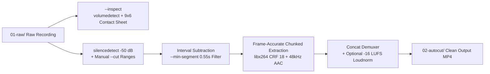

# 🎬 Agentic Media & Asset Production Pipeline


Deterministic, zero-external-Python-dependency media automation CLI built to turn raw screen recordings into publication-ready edits automatically.

---

## 🏗️ Pipeline Architecture



---

## 📊 Verified Production Benchmark

Tested on a real 27-minute raw screen recording (YouTube EP #1 production):

| Metric | Raw Recording (`01-raw/`) | After `auto_cut_video.py` (`02-autocut/`) |
| :--- | :---: | :---: |
| **Duration** | `27:00` | `10:37` *(dead air & retakes stripped)* |
| **Mean Audio Volume** | `-41.8 dB` | `-20.1 dB` *(normalized toward `-16 LUFS` target)* |
| **External Python Packages** | — | `0` *(Python stdlib + FFmpeg only)* |

---

## 🚀 Quickstart & Usage (`auto_cut_video.py`)

Requires **Python 3.9+** and **FFmpeg / FFprobe** (`winget install Gyan.FFmpeg` on Windows, `brew install ffmpeg` on macOS).

```bash
# 1. Inspect audio loudness and generate a 9x6 overview contact sheet (no render)
python scripts/auto_cut_video.py input.mp4 --inspect

# 2. Preview kept segments without rendering
python scripts/auto_cut_video.py input.mp4 --remove-silence --dry-run

# 3. Auto-cut silence and normalize loudness to YouTube standard (-16 LUFS)
python scripts/auto_cut_video.py input.mp4 --remove-silence --normalize

# 4. Combine manual exclusion ranges with automatic silence removal
python scripts/auto_cut_video.py input.mp4 --cut 04:30-06:45 --remove-silence --normalize
```

---

## ⚙️ Key CLI Flags

| Flag | Default | Description |
| :--- | :---: | :--- |
| `--latest` | `off` | Auto-select the newest video in `media/01-raw/` |
| `--inspect` | `off` | Run `volumedetect` and generate a 9×6 contact sheet in `media/_scratch/` |
| `--cut MM:SS-MM:SS` | `[]` | Manual time range(s) to exclude (repeatable) |
| `--remove-silence` | `off` | Enable automatic silence detection and removal |
| `--noise-db` | `-50.0` | Silence threshold in dB |
| `--min-silence` | `0.9` | Minimum silence span (seconds) required to cut |
| `--pad` | `0.2` | Speech boundary padding (seconds) to avoid abrupt cuts |
| `--min-segment` | `0.55` | Minimum kept speech segment (seconds) to filter out mouse clicks |
| `--normalize` | `off` | Apply YouTube-standard `-16 LUFS` loudness normalization |
| `--dry-run` | `off` | Print planned cut segments without rendering video |

---

## 📁 Repository Structure

- `scripts/auto_cut_video.py` — Zero-dependency Python CLI wrapping `ffmpeg` & `ffprobe`
